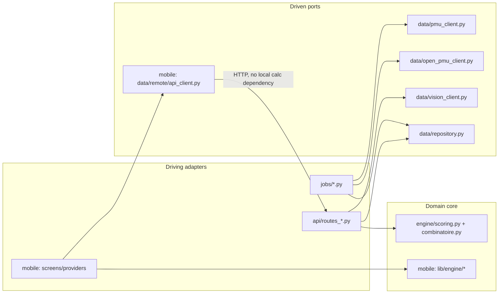
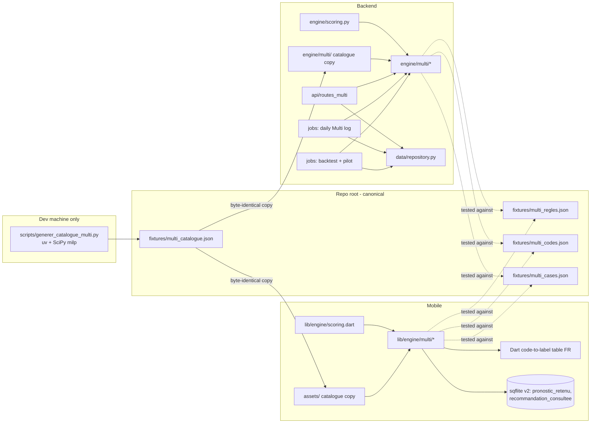

# Architecture Spine — prediction-hyppique

## Design Paradigm

**Hexagonal (ports and adapters)** — ratified from the existing codebase, not invented.

- **Domain core** (`backend/app/engine/`) — `scoring.py`, `combinatoire.py`, `constants.py`. Pure functions and dataclasses; zero dependency on FastAPI, SQLAlchemy, or any I/O library. This is the one piece both backend and mobile re-implement (Python here, Dart in `mobile/lib/engine/`) — see AD-2 for how the two stay in sync.
- **Driven ports (adapters the core doesn't know about)** — `data/pmu_client.py`, `data/open_pmu_client.py`, `data/vision_client.py` (AD-3), `data/repository.py`. Each is the *only* module that knows its external format; nothing else reads a raw PMU/vision JSON field or a raw SQL row.
- **Driving adapters** — `api/routes_*.py` (FastAPI), `jobs/*.py` (scheduled ingestion), the Flutter `screens/`+`providers/` layer. These call into the core/ports; the core never calls back into them.
- **Multi sub-core** (`backend/app/engine/multi/`, mirrored in `mobile/lib/engine/multi/`) — a downstream consumer of the scoring core (AD-6), reading a reduced-systems catalogue generated offline (AD-7). The only heavy computation of the Multi module, the systems generator, sits outside the hexagon entirely: a developer-run script, never deployed.



Multi module (AD-6 to AD-11):



## Invariants & Rules

### AD-1 — Hexagonal boundary is binding, not advisory

- **Binds:** all backend modules (`app/engine/`, `app/data/`, `app/api/`, `app/jobs/`) and their mobile mirrors (`lib/engine/`, `lib/data/`, `lib/screens/`+`lib/providers/`).
- **Prevents:** a future story reaching around the port to call an external format directly (e.g. a route parsing raw PMU JSON, or a screen calling Anthropic directly instead of through the backend `/extraction/*` endpoints — already an explicit NFR, PRD §8).
- **Rule:** `engine/` never imports from `data/`, `api/`, or any I/O/HTTP library. `data/*_client.py` and `data/vision_client.py` are the only modules that deserialize their respective external formats — every other module receives already-normalized dataclasses/models. [ADOPTED]

### AD-2 — Backend/mobile engine parity via shared fixtures, not hand-duplicated tests or constants

- **Binds:** `backend/app/engine/` (`scoring.py`, `combinatoire.py`, `constants.py`), `backend/tests/test_scoring.py`, `backend/tests/test_combinatoire.py`, `mobile/lib/engine/`, `mobile/test/engine/scoring_test.dart`.
- **Prevents:** the Python and Dart ports of the scoring engine silently diverging — either because a story on one side adds a test case or a default parameter that never gets mirrored to the other, **or** because the four coefficient tables (terrain, niveau, incidents, récence) get hand-copied once and then edited independently later. Both are the same failure shape; scoping the fix to test cases alone would leave the constants tables — an equally real divergence point — uncovered.
- **Rule:** two files at the repository root (neutral — owned by neither `backend/` nor `mobile/`):
  - `fixtures/engine_cases.json` — every test case expressible as fixed-input → fixed-or-tolerance-checked-output (probability-sum invariants, Bayesian-shrinkage bounds, the value/Kelly worked example, terrain/niveau=`None` neutrality) **and** the canonical default engine parameters (mirrors `DEFAULT_PARAMETERS` in `constants.py` / `EngineParams()` in Dart). Both `test_scoring.py`/`scoring_test.dart` and both production default-parameter objects are generated from or validated against this file — never hand-encoded independently.
  - `fixtures/engine_constants.json` — the four coefficient tables (`TERRAIN_COEFFICIENTS_GRASS`, `TERRAIN_COEFFICIENTS_PSF`, `NIVEAU_COEFFICIENTS`, `INCIDENTS`, `RECENCE_STD`/`FORME`/`FLAT`). `constants.py` and `constants.dart` both load or are validated against this file, never re-typed by hand on either side.
  - **Monte-Carlo carve-out:** `couple_place`/`deux_sur_quatre` results (from `monte_carlo_place_probabilities` in Python, its Dart equivalent) are **not** eligible for exact cross-language fixture comparison — `numpy.random.default_rng` and Dart's `Random` are different algorithms, so identical seeds do not produce identical draws. These stay covered by same-language determinism/seed-sensitivity tests only (already the shape of `test_monte_carlo_place_deterministe_avec_seed_fixe`); cross-language parity for this family is a statistical-tolerance check (e.g. both within N% of the same analytically-expected range), never a fixture equality assertion.
  - Comparative/structural tests that assert a *relationship* between two computed results in the same test (disqualification-vs-chute ordering, désordre/ordre ratio growth by depth) stay hand-written per language — they encode the property in the assertion itself, not a value that can silently drift. [decided this run; widened after adversarial + rubric-walker review]

### AD-3 — Vision extraction is an isolated, budget-guarded port

- **Provenance:** the vendor choice (Anthropic Claude) is a decision made *in this session* by the user — it does not trace to the PRD, either cahier des charges, or the brief. Re-verify the exact model name/version against Anthropic's current lineup before pinning it in `vision_client.py`; do not assume the model string used in the old JS prototype (`claude-sonnet-4-6`) is still current.
- **Binds:** `backend/app/data/vision_client.py` (not yet created), `backend/app/api/routes_analyse.py` (`/extraction/fiche`, `/extraction/programme`).
- **Prevents:** (a) an Anthropic API key or raw vision-provider call shape leaking outside one module — mirrors AD-1 for the PMU adapters, and is the mechanism behind the PRD's "no third-party API key client-side" acceptance criterion (cahier mobile §11); (b) a runaway loop or logic bug silently exhausting a paid-per-call budget with no operator visibility.
- **Rule:** `vision_client.py` is the sole module that knows the Anthropic request/response shape, exposing normalized `extract_fiche_cheval(image) -> FicheChevalExtraite` / `extract_programme(image) -> ProgrammeExtrait`. It enforces a daily call counter (in-memory or a simple DB table) against a configurable ceiling (`VISION_DAILY_CALL_LIMIT` env var) — past the ceiling, calls are refused and logged loudly rather than silently continuing. The ceiling's actual value is intentionally not fixed here — it's the PRD's own open question (§9.4, §11.4). [decided this run]

### AD-4 — API responses are typed, never raw `.__dict__` dumps

- **Binds:** every FastAPI route returning engine results (`api/routes_analyse.py` today; any future route with the same shape).
- **Prevents:** two spine-compliant stories drifting apart because one adds a field by mutating `HorseAnalysis` and letting `__dict__` carry it through untyped, while another "fixes" the endpoint to strictly match the `HorseOut` Pydantic schema — each is a reasonable reading of currently-uncodified behavior, and they produce different wire payloads.
- **Rule:** every API response is built from its declared Pydantic schema (`response_model` on the route, or an explicit `.model_validate(...)`/constructor call) — never `some_dataclass.__dict__` passed straight into a `Dict`-typed response field. **Existing violation, not hypothetical:** `routes_analyse.py`'s `/analyse` currently does exactly this (`resultats=[horse.__dict__ for horse in results]` typed as `List[Dict]` in `AnalyseOut`, bypassing the already-defined `HorseOut` schema) — logged as a fix-forward item in `deferred-work.md`, not silently left as an example to copy. [decided this run, adversarial review]

### AD-5 — Terrain/niveau travel as canonical label strings, never pre-resolved floats

- **Binds:** the `Performance`/`CourseTarget` wire shape (API JSON, DB storage) on both backend and mobile; `constants.py`'s `terrain_coefficient()` and its Dart equivalent; the not-yet-existing `niveauCoefficient()`-equivalent lookup on the mobile side.
- **Prevents:** one side sending a resolved float (`1.0`) and the other a label (`"Bon"`) for the same concept — silently "working" until a label the receiving side's lookup table doesn't recognize arrives, at which point today's code coerces it to the same neutral value used for genuinely-missing data, making the two cases indistinguishable in logs or the UI's "terrain inconnu" counter (cahier backend §7.5, PRD FR-5).
- **Rule:** `terrain` and `niveau` are transmitted and stored as their canonical French label strings (`"Bon"`, `"Catégorie B"`, …) — coefficient resolution happens only at the point of use, via each side's own mirrored lookup table (`terrain_coefficient()` today; `niveauCoefficient()` needs writing on the mobile side — currently missing per adversarial review). An **unrecognized** label is a distinct, logged condition (`terrain_label_unrecognized` or equivalent) — never silently collapsed into the same code path as a `null`/genuinely-absent value, even though both currently resolve to the same neutral coefficient (`1.0`) for the calculation itself. [decided this run, adversarial review]

### AD-6 — The Multi engine consumes the scoring core and a server-built race context; the phone always computes locally

- **Binds:** `backend/app/engine/multi/` and `mobile/lib/engine/multi/` (modules `regles`, `couverture`, `recommandation`, `confiance`, `explications`, `verification`, comparators); `fixtures/multi_cases.json`; every caller of the Multi engine (routes, jobs, Flutter providers); the data adapters that prepare its inputs.
- **Prevents:** the Multi screen and the Results screen disagreeing about the same horse because a story recomputed scores, Top4 or value inside the Multi code; the Python and Dart engines picking different recommendations for the same race; a phone that cannot give a confidence index offline because some input only exists on the server.
- **Rule:** the Multi engine's inputs are (1) the scoring core's output for the race (win probabilities, `top4`, `value`, transparency flags, virtual runners) and (2) a **Multi race context** built by the backend and delivered with the race's runners: eligibility (support race, declared runners), model evaluation status, and whether the confidence-index thresholds are still provisional. It carries no money figure (no rapport, no R7, no cost): the Multi is a forecast (cahier Multi v3). The phone caches that context with the race and **always computes the forecast (selection at the user-chosen size, candidate bases, systems for every formula), the confidence index and explanations with the Dart engine**, online or not; it never calls `/multi/recommandation`, which serves the backend's own jobs and non-mobile clients. The engine never computes a score, reads a database or the network (AD-1); M1 inputs (last-race rank, allocation, decoded *musique*) are normalized in the data layer (`pmu_client.py` / `repository.py`), never parsed inside the engine. Every Multi module except the generator and the B0 random comparator (logged by the backend only) exists in Python and Dart, with fixed-input cases in `fixtures/multi_cases.json` run by both suites (AD-2). Probabilities are compared after quantization to a 1e-9 grid, so equality is transitive and ties go to the cahier's tie rules; any iteration cap on the selection search is a shared constant, identical on both sides. [decided this run, tightened at review; amended 2026-10-18 — no money in the context]

### AD-7 — Reduced systems come from an offline-generated, verified, versioned catalogue; rules have one canonical file

- **Binds:** `scripts/generer_catalogue_multi.py`; `fixtures/multi_catalogue.json`, `fixtures/multi_regles.json`; the copies `backend/app/engine/multi/multi_catalogue.json` and `mobile/assets/multi_catalogue.json`; `regles.py` / `regles.dart`; `mobile/pubspec.yaml` assets.
- **Prevents:** a MILP solver running in production on the SSE2-only VPS; backend and mobile serving different systems — or different tickets — for the same selection; the betting rules drifting between languages after the pmu.fr check (PRD §9.5); a story following the cahier's superseded design (server-side generator, `multi_systeme_cache`, `export_multi_catalog.py`).
- **Rule:**
  - **Precedence.** For where systems are produced, stored and read, this AD supersedes cahier Multi §2 (rules location), §5.2, §7 (`multi_systeme_cache`) and §11.3.
  - **Generator.** Runs only on a developer machine, as a standalone script with inline (PEP 723) dependencies run by `uv`, pinned (`scipy==1.18.1`, a NumPy 2.x pin, `requires-python`, `exclude-newer`); never imported by the backend nor installed in production. It writes the canonical catalogue to `fixtures/multi_catalogue.json` and copies it into `backend/app/engine/multi/` and `mobile/assets/`; a test per language asserts byte-identity with the canonical file.
  - **Catalogue shape.** A header (`version` = sha256 of the entries, sha256 of `multi_regles.json` used, SciPy/HiGHS versions) and entries keyed by `(v', k', t')`, each a list of blocks over indices `0..v'-1`, verified at generation. Any test of the catalogue runs without SciPy.
  - **Relabelling.** One canonical mapping, identical in both languages: the non-base horses of the selection, sorted by `top4` descending, then win probability descending, then dossard ascending, take indices `0..v'-1`; each ticket is the bases plus the mapped block. Shared cases compare full ticket lists, not just counts. Every relabelled system is re-verified before it is shown.
  - **Runtime.** Nothing generates systems at runtime; a shape missing from the catalogue gets no system and a warning.
  - **Rules.** `fixtures/multi_regles.json` holds unit stake, formulas, rapport coefficients, minimum rapports, support-race criteria, non-runner requalification and a mandatory `date_verification`; `regles.py` and `regles.dart` are validated against it; without a verification date no grid is displayed (FR-22); the money constants stay in the file for completeness but are never used by the forecast nor displayed; any change regenerates the catalogue. [decided this run, tightened at review; amended 2026-10-18]

### AD-8 — Explanations travel as registered codes, never sentences

- **Binds:** `fixtures/multi_codes.json`; both Multi engines; the Multi API responses; the mobile code-to-label table.
- **Prevents:** the two engines emitting different codes, or the same code with different parameters, and the screen silently showing nothing (or a raw code) for one of them; French sentences hard-coded in the engine or API, which would force an engine rewrite when English arrives (PRD §8).
- **Rule:** every explanation, reason and warning produced by the Multi engine is a `(code, params)` pair whose code and parameter names are declared in `fixtures/multi_codes.json`. Tests in both languages assert that the engine emits only declared codes with their declared parameters; a mobile test asserts every declared code has a label. For the MVP the app renders codes through a plain Dart table mapping each code to a French sentence template; migrating that table to Flutter's localization tooling is deferred to the English release. [decided this run]

### AD-9 — The retained forecast lives on the device only, in the existing SQLite cache

- **Binds:** `mobile/lib/data/local/database_helper.dart` (schema version 1 → 2), the Multi providers, the next-day debrief.
- **Prevents:** debrief history stored in a settings store; the retained forecast leaking to the server in a V1 that has no account (PRD §9.1); fresh installs and upgraded installs ending up with different local schemas.
- **Rule:** the retained forecast (« pronostic retenu », formerly « jeu retenu ») and the model forecast consulted with it are stored in two new tables of `hippique_cache.db` (`pronostic_retenu` — renamed from `jeu_retenu`, never shipped — and `recommandation_consultee`, name kept), each referencing the race by its stable key and carrying the recommendation identity (AD-12). `onCreate` builds schema version 2 directly and `onUpgrade` migrates 1 → 2; both paths are tested. A retained forecast is replaceable until the race's departure time and frozen afterwards (UTC comparison, AD-12). Entries older than 90 days are purged at app start-up (no background task). Confidence-index thresholds and the last-used selection size are user settings stored in `shared_preferences` with the other engine parameters (FR-20). Nothing of this is sent to the backend. [decided this run, tightened at review; amended 2026-10-18 — retained forecast]

### AD-10 — Server-side Multi records: one writer per table, through the repository; the daily log is append-only

- **Binds:** `backend/app/data/models.py`, `backend/app/data/repository.py`, `backend/app/jobs/`, `api/routes_multi`.
- **Prevents:** a route or job writing Multi tables directly; two jobs both writing outcomes or arrivals; a correction overwriting a logged recommendation; failure entries colliding with the uniqueness rule of logged recommendations.
- **Rule:** French-named tables, read and written only through `repository.py`, each with a single writer:

  | Table | Content | Sole writer |
  | --- | --- | --- |
  | `multi_course` | eligibility, arrival with ties (no rapports) | ingestion/finalisation job |
  | `recommandation_multi` | logged model forecasts (with confidence level) and comparators, unique per (race key, strategy, strategy version, mode, reference size) | daily Multi log job |
  | `echec_journal_multi` | daily runs that could not log, with reason | daily Multi log job |
  | `resultat_recommandation` | outcome of each logged entry: horses captured (0–4), arrival in selection — no cost or gain | finalisation job |
  | `performance_strategie` | backtest/pilot results | backtest import command (AD-11) |

  `recommandation_multi` rows are never updated or deleted; a correction is a new strategy version. The daily Multi log runs in the `ingestion` container and starts only once the pilot has fixed the reference sizes (PRD §6.1). Table names are kept; they now hold forecasts. How these tables and the new M1 columns reach an existing production database is decided by AD-13. [decided this run, tightened at review; amended 2026-10-18 — no rapports]

### AD-11 — The backtest is a backend job, location-agnostic; its results reach production by an explicit import

- **Binds:** the backtest/pilot harness and its import command in `backend/app/jobs/`; `fixtures/multi_parametres_pilote.json`; `/multi/performance`; the future `/multi/backtest`.
- **Prevents:** a developer-machine-only harness rewritten when evaluation moves to a server; pilot results stranded in a database copy while production shows nothing; Python, Dart and the daily job each taking the pilot's defaults from a different place.
- **Rule:** the harness is a driving adapter in `backend/app/jobs/`, configured solely by `DATABASE_URL`, calling the Multi engine and `repository.py` like any other job. It runs first on the developer machine against a copy of the production database, later on a server, with the same code. Its results are exported to a file and loaded into production by an import command of the same module, through `repository.py`; `/multi/performance` only reads `performance_strategie`. The values the pilot fixes — default confidence-index thresholds (per selection size), reference sizes, minimum sample size for displaying performances, and the "provisional" flag — live in `fixtures/multi_parametres_pilote.json`, validated by both languages' tests and read by the daily job (AD-2 pattern). `/multi/backtest` is built only when the harness moves to a server. [decided this run, tightened at review; amended 2026-10-18]

### AD-12 — Race identity, recommendation identity and time are fixed shapes

- **Binds:** every Multi table on server and device, the Multi race context, the debrief, the daily log, the backtest, `pmu_client.py`.
- **Prevents:** the phone and the server naming the same race or recommendation differently, so the debrief and the evaluation cannot be joined; a departure-time freeze two hours off because a time was stored naive in the container's zone and read as local on the phone.
- **Rule:** a race is identified across systems by its PMU key (date, `numero_reunion`, `numero_course` — already unique in `courses`), never by an autoincrement id; a horse by `num_pmu` within that race only. A recommendation is identified by the tuple (race key, Multi engine version, catalogue `version`, rules hash, parameters hash, data timestamp); the engine version lives in `fixtures/multi_versions.json` with the registry and pilot-parameter versions, and the tuple is stored in both `recommandation_multi` and `recommandation_consultee`. Every instant is stored and transmitted as UTC ISO-8601 with offset; the departure-time freeze, "logged before departure" and backtest cut-offs compare UTC instants. `pmu_client._epoch_ms_to_datetime`'s naive `fromtimestamp` is a live defect against this rule (logged in `deferred-work.md`). [decided this run, review]

### AD-13 — Server schema changes go through Alembic only

- **Binds:** `backend/alembic/` (environment and revisions), `backend/app/data/models.py`, `backend/app/data/repository.py`, the `api` service start-up, backend tests.
- **Prevents:** new columns (M1's allocation, raw rank, arrival status…) never reaching the existing production SQLite file because `create_all` only creates missing tables; two services migrating the same SQLite file at the same time; a model change shipped without its migration.
- **Rule:** every server schema change ships as an Alembic revision under `backend/alembic/` (inside the Docker build context). The existing production schema is the baseline revision, stamped once on the live database. `alembic upgrade head` runs at start-up of the `api` service only, before uvicorn; the `ingestion` service never migrates. `repository.py` no longer calls `create_all` against a real database (tests on a throw-away database may). A backend test asserts that the models and the head revision agree (empty autogenerate diff). [decided this run]

### AD-14 — A trained model is a backend reference engine; the Dart engine becomes the expert mode (conditional)

- **Condition:** this decision activates only when a backend-trained model (for example a gradient-boosted model fitted on the rebuilt turfinfo history) beats the market benchmark: closing-odds log-loss, out-of-time backtest, a bootstrap confidence interval that excludes zero, then confirmed on live predictions. Until then AD-2 and AD-6 apply unchanged: both engines compute the same scoring, and the phone always computes locally.
- **Binds:** `backend/app/engine/` (the model's inference path), the race payload served to the app, `mobile/lib/engine/`, `mobile/lib/providers/`, the prediction log and dashboard (`prediction_runs`, `/dashboard`).
- **Prevents:**
  - a trained model reimplemented, approximated or shipped as a binary in Dart;
  - two "official" probabilities shown for the same race;
  - value, Kelly, combinations and the Multi computed twice from different inputs;
  - the offline mode, photo-imported races and the user's sliders lost because the reference moved to the server.
- **Rule:** once the condition is met:
  - **Backend.** The model runs only on the backend, where it is trained and measured. Its win probabilities are the **reference probabilities**: they are logged before the start (the existing dashboard measures them) and served with the race's runners, versioned (model version, data timestamp). The phone caches them with the race, as it caches the Multi race context.
  - **Phone, Dart engine.** The current scoring engine stays on the phone and becomes the **expert engine**: the user's "make my own pronostic" mode with adjustable coefficients, and the fallback for photo-imported races, offline races and races with no reference probabilities. AD-2 parity fixtures keep binding it to its Python twin.
  - **Display.** The reference probabilities are the default. The expert engine's are shown only when the user chose that mode, and they are always labelled as such. The two are never blended silently.
  - **Downstream of probabilities.** Value, Kelly, combinations and the Multi forecast (AD-6) stay single implementations on the phone. They take whichever probability set is active as input, and nothing downstream is duplicated.
- **Review trigger:** if the model stops beating the market on live predictions over the evaluation window, the reference falls back to the scoring engine and the dashboard says so. [decided 2026-10-22, conditional — Lazyd with Winston, Mary, John]

## Consistency Conventions

| Concern | Convention |
| --- | --- |
| Naming (entities, fields) | French domain vocabulary end-to-end — `nom`, `cote`, `dossard`/`num_pmu`, `forme`, `score`, `probabilite`, `value`, `kelly`, `mise`, `inedit`, `partants`. Identical spelling in Python dataclasses, JSON API payloads, and Dart models — never translated to English — **for the engine-facing shape** (`HorseAnalysis`/`Performance` and their JSON mirror). A DB/API schema serving a genuinely different bounded context (e.g. `ParticipationOut`'s course-specific `age_a_la_course`/`cote_reference` vs. the ad-hoc-analysis `HorseIn`'s `age`/`cote`) may legitimately use different names for an equivalent concept — the requirement is that the translation between them happens in one explicit mapping function (already the pattern: `_build_horse_analysis()`), never implicitly assumed identical. [narrowed after adversarial review — the original unqualified claim didn't hold for `ParticipationOut` vs `HorseIn`] |
| Data & formats | A cross-course-stable horse identity is the normalized name (`nom_normalise`); `num_pmu` is valid only within one course (cahier backend §6.2 — a documented pitfall, not a design choice made here). `terrain`/`niveau`/`distance` on a `Performance` are nullable and mean "neutral coefficient," never a guessed default — this rule already governs the engine (§7.5) and extends verbatim to every future field with the same shape (see AD-5 for the wire-format corollary). |
| State & cross-cutting | Mobile local calculation never depends on network reachability once a course is cached (PRD FR-13) — this includes the whole Multi forecast and confidence index; the network-dependent features (photo import, refreshing odds, non-runners and arrivals) fail visibly and leave the rest of the screen usable (FR-15). No third-party API key ever ships in the mobile binary (AD-3). API responses are always typed (AD-4), Multi routes included. |
| Multi naming | French domain vocabulary end-to-end for Multi shapes as well (`selection`, `bases`, `tickets`, `p_couverture`, `confiance`, `explications`), matching the cahier Multi v3; English never appears in a Multi identifier, table or JSON key. |

## Stack

| Name | Version |
| --- | --- |
| Python | 3.12 (`backend/Dockerfile`) — bugfix support has ended; security-fix-only until Oct 2028. Not a blocker, worth knowing before a future story picks a 3.12-only feature that later needs backporting. |
| FastAPI | latest at `requirements.txt` resolution (unpinned) [ASSUMPTION: acceptable for a solo bootstrap backend; pin if this becomes a concern] |
| SQLAlchemy | latest at `requirements.txt` resolution (unpinned) [ASSUMPTION: same risk as FastAPI, same acceptance for now] |
| Flutter/Dart | Flutter 3.47.1 / Dart 3.13.1 current stable, verified compatible with `mobile/pubspec.yaml`'s `sdk: ^3.12.0` constraint (verified this run — replaces prior hedge) |
| Riverpod | `^3.4.2`, mobile state management [ADOPTED — cahier mobile §5.1; verified current major line] |
| sqflite | `^2.4.3`, mobile local cache [ADOPTED — cahier mobile §9; verified current, not deprecated] |
| dio | `^5.11.0`, mobile HTTP client [ADOPTED — cahier mobile §9, chosen over `http` for timeout/retry handling on unreliable trackside connections; verified current] |
| freezed + json_serializable | per `mobile/pubspec.yaml`, mobile model codegen [ADOPTED — cahier mobile §9, immutable models + JSON parity with backend schemas] |
| NumPy (backend runtime) | `1.26.4`, pinned for the SSE2-only production VPS (commit `2bb2518`) [ADOPTED]. Its wheels stop at cp312, which locks the backend image to Python 3.12; NumPy 2.0–2.3 would also run on that CPU (the x86-64-v2 baseline arrives in 2.4) — a possible future bump, not decided here. |
| SciPy (systems generator, dev machine only) | `1.18.1` (2026-08-21; PyPI: `requires_python >=3.12`, `numpy>=2.0,<2.8`, wheels cp312–cp315) — pinned in the generator's inline dependencies, never in the backend environment, because it needs NumPy ≥ 2 (AD-7); `scipy.optimize.milp` (HiGHS) since 1.9 |
| Alembic | `1.20.0` (PyPI, `requires_python >=3.10`), backend runtime dependency for schema migrations (AD-13) |
| uv | runs the generator script with its inline dependencies (installed on the dev machine, 0.13.1) |
| Vision provider | Anthropic Claude — model name/version deliberately left unpinned here; see AD-3 Provenance. Not sourced from any prior planning document. |

## Structural Seed

```text
{repo-root}/
  fixtures/
    engine_cases.json       # AD-2: shared test cases + canonical default params
    engine_constants.json   # AD-2: shared terrain/niveau/incidents/recence tables
    multi_regles.json       # AD-7: canonical betting rules
    multi_catalogue.json    # AD-7: canonical verified systems catalogue
    multi_codes.json        # AD-8: explanation code registry
    multi_cases.json        # AD-6: shared Multi test cases
    multi_parametres_pilote.json  # AD-11: pilot-fixed defaults
    multi_versions.json     # AD-12: Multi engine / registry / parameter versions
  scripts/
    generer_catalogue_multi.py  # AD-7: dev-machine only, uv + inline deps
  backend/
    app/
      engine/                # domain core (hexagon center)
        multi/               # AD-6: Multi sub-core + catalogue copy (AD-7)
      data/                  # driven ports/adapters
      api/                   # driving adapters (HTTP)
      jobs/                  # driving adapters (scheduled)
    alembic/                 # AD-13: schema migrations (baseline + revisions)
  mobile/
    lib/
      engine/                # domain core, Dart mirror
        multi/               # AD-6: Dart mirror of the Multi sub-core
      data/                  # driven ports/adapters, Dart mirror
      screens/ + providers/  # driving adapters (UI)
    test/engine/              # loads fixtures/engine_cases.json (AD-2) and multi_*.json (AD-6/7/8)
    assets/multi_catalogue.json  # AD-7: byte-identical copy
```

## Deferred

- **Deployment/environments beyond what `docker-compose.yml` already fixes.** Two self-hosted services (`api`, `ingestion`) sharing a SQLite volume are already [ADOPTED] from the existing compose file — that's not re-decided here. No CI/CD pipeline, no staging environment, and no mobile store distribution exist yet; deferred by explicit project posture (brief §6, PRD §9.3/§10 — bootstrap, no fixed timeline, traction-gated). Revisit when a second environment or a release channel is actually needed.
- **`VISION_DAILY_CALL_LIMIT`'s actual value and the vision budget it protects.** Mechanism fixed (AD-3); the number is PRD Open Question 4 (§9.4, §11.4) — not an architecture decision.
- **Niveau-from-allocation quantile calibration** (cahier backend §7.2, PRD Open Question 5) — a data-calibration task once real ingested volume exists, not a structural decision.
- **Homonym disambiguation for `nom_normalise`** (PRD Open Question 7) — accepted risk until a real collision surfaces; no structural hook needed today.
- **Size of the systems catalogue.** Unknown until the first generation (selections up to 20 horses, 0–3 bases, tickets of 4–7). Measure then; if it weighs on the APK or the repository, compress the canonical file and its copies (the byte-identity rule of AD-7 applies to the compressed form).
- **Localization tooling.** The Dart code-to-label table (AD-8) is migrated to Flutter's localization tooling when English is added after the MVP (PRD §8); the tooling's current setup is verified then, not now.
- **Backtest on a server.** When the harness (AD-11) moves off the developer machine: which host, how it is triggered, and the `/multi/backtest` endpoint. Revisit when the pilot needs to run regularly.
- **Betting rules verification** (PRD §9.5) is a product prerequisite, not an architecture decision: it fills `fixtures/multi_regles.json`; AD-7 only fixes where the result lives.
- **Where the support-race marker and the arrival with ties sit in the PMU source** (PRD Open Question 9) — discovered inside `pmu_client.py` (AD-1); no structural hook needed beyond AD-10. Multi rapports are out of scope since 2026-10-18 (the Multi is a forecast): not ingested, not stored, not displayed.
- **Operations of the Multi jobs.** Schedule of the daily Multi log relative to departure times, and backup of the production SQLite file (now the only home of logged recommendations): decide when increment 2 starts.
- **Local test environment vs production.** The backend's local virtualenv runs Python 3.15 / NumPy 2.x while production runs 3.12 / 1.26.4; running backend tests under `uv` with Python 3.12 and the pinned requirements would close the gap. Revisit before the Multi engine's numeric fixtures are frozen.
- **Payment/account/multi-user architecture.** Explicitly out of MVP scope (PRD §6.2, §9.1) — revisit only once the V2 monetization gate (PRD §10) is met.
