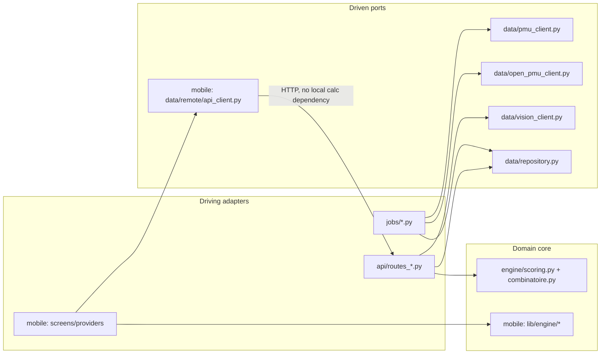
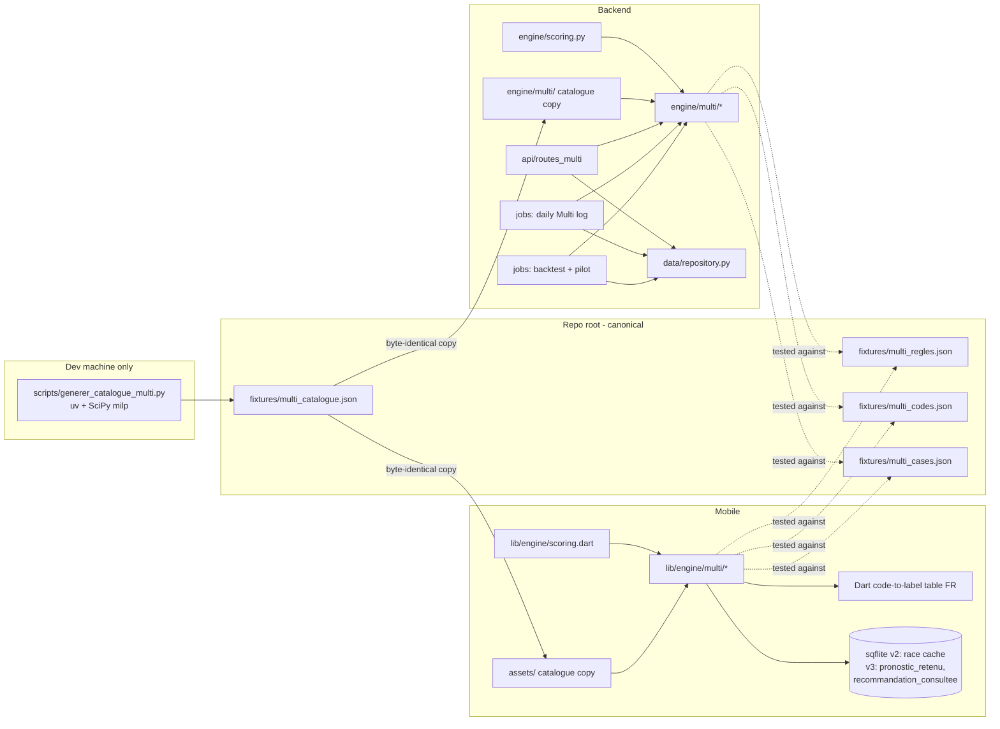
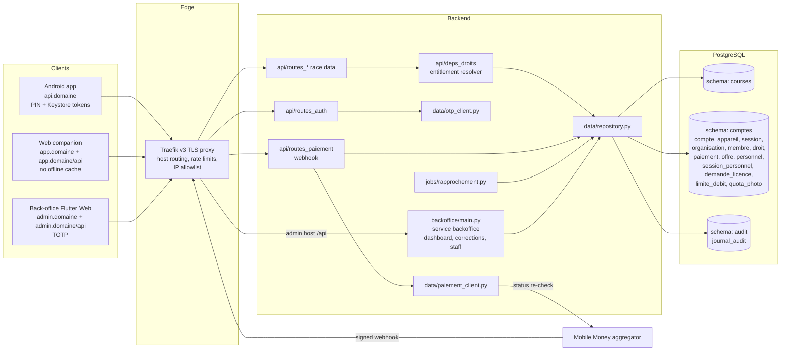

# Architecture Spine — prediction-hyppique

## Design Paradigm

**Hexagonal (ports and adapters)** — ratified from the existing codebase, not invented.

- **Domain core** (`backend/app/engine/`) — `scoring.py`, `combinatoire.py`, `constants.py`. Pure functions and dataclasses; zero dependency on FastAPI, SQLAlchemy, or any I/O library. This is the one piece both backend and mobile re-implement (Python here, Dart in `mobile/lib/engine/`) — see AD-2 for how the two stay in sync.
- **Driven ports (adapters the core doesn't know about)** — `data/pmu_client.py`, `data/open_pmu_client.py`, `data/vision_client.py` (AD-3), `data/otp_client.py` (AD-16), `data/paiement_client.py` (AD-17), `data/repository.py`. Each is the *only* module that knows its external format; nothing else reads a raw PMU/vision JSON field or a raw SQL row.
- **Driving adapters** — `api/routes_*.py` (FastAPI, every route behind the entitlement dependency of AD-15), `jobs/*.py` (scheduled ingestion, odds snapshots, published forecasts, reconciliation), the Flutter `screens/`+`providers/` layer (Android app and web companion), and the back-office (AD-20: `backend/app/backoffice/` FastAPI entry point + `backoffice_web/` Flutter Web). These call into the core/ports; the core never calls back into them.
- **Multi sub-core** (`backend/app/engine/multi/`, mirrored in `mobile/lib/engine/multi/`) — a downstream consumer of the scoring core (AD-6), reading a reduced-systems catalogue generated offline (AD-7). The only heavy computation of the Multi module, the systems generator, sits outside the hexagon entirely: a developer-run script, never deployed.



Multi module (AD-6 to AD-11):



Accounts, entitlements and payments (AD-15 to AD-21):



## Invariants & Rules

### AD-1 — Hexagonal boundary is binding, not advisory

- **Binds:** all backend modules (`app/engine/`, `app/data/`, `app/api/`, `app/jobs/`) and their mobile mirrors (`lib/engine/`, `lib/data/`, `lib/screens/`+`lib/providers/`).
- **Prevents:** a future story reaching around the port to call an external format directly (e.g. a route parsing raw PMU JSON, or a screen calling Anthropic directly instead of through the backend `/extraction/*` endpoints — already an explicit NFR, PRD §8).
- **Rule:** `engine/` never imports from `data/`, `api/`, or any I/O/HTTP library. `data/*_client.py` and `data/vision_client.py` are the only modules that deserialize their respective external formats — every other module receives already-normalized dataclasses/models. [ADOPTED]

### AD-2 — Backend/mobile engine parity via shared fixtures, not hand-duplicated tests or constants

- **Binds:** `backend/app/engine/` (`scoring.py`, `combinatoire.py`, `constants.py`), `backend/tests/test_scoring.py`, `backend/tests/test_combinatoire.py`, `mobile/lib/engine/`, `mobile/test/engine/scoring_test.dart`.
- **Prevents:** the Python and Dart ports of the scoring engine silently diverging — either because a story on one side adds a test case or a default parameter that never gets mirrored to the other, **or** because the four coefficient tables (terrain, niveau, incidents, récence) get hand-copied once and then edited independently later. Both are the same failure shape; scoping the fix to test cases alone would leave the constants tables — an equally real divergence point — uncovered.
- **Rule:** two files at the repository root (neutral — owned by neither `backend/` nor `mobile/`):
  - `fixtures/engine_cases.json` — every test case expressible as fixed-input → fixed-or-tolerance-checked-output (probability-sum invariants, Bayesian-shrinkage bounds, the value/Kelly worked example, terrain/niveau=`None` neutrality) **and** the canonical default engine parameters (mirrors `DEFAULT_PARAMETERS` in `constants.py` / `EngineParams()` in Dart). Both `test_scoring.py`/`scoring_test.dart` and both production default-parameter objects are generated from or validated against this file — never hand-encoded independently.
  - `fixtures/engine_constants.json` — the four coefficient tables (`TERRAIN_COEFFICIENTS_GRASS`, `TERRAIN_COEFFICIENTS_PSF`, `NIVEAU_COEFFICIENTS`, `INCIDENTS`, `RECENCE_STD`/`FORME`/`FLAT`). `constants.py` and `constants.dart` both load or are validated against this file, never re-typed by hand on either side.
  - **Monte-Carlo carve-out:** `couple_place`/`deux_sur_quatre` results (from `monte_carlo_place_probabilities` in Python, its Dart equivalent) are **not** eligible for exact cross-language fixture comparison — `numpy.random.default_rng` and Dart's `Random` are different algorithms, so identical seeds do not produce identical draws. These stay covered by same-language determinism/seed-sensitivity tests only (already the shape of `test_monte_carlo_place_deterministe_avec_seed_fixe`); cross-language parity for this family is a statistical-tolerance check (e.g. both within N% of the same analytically-expected range), never a fixture equality assertion.
  - Comparative/structural tests that assert a *relationship* between two computed results in the same test (disqualification-vs-chute ordering, désordre/ordre ratio growth by depth) stay hand-written per language — they encode the property in the assertion itself, not a value that can silently drift. [decided this run; widened after adversarial + rubric-walker review]
  - **Runtime mirrors of root fixtures.** `fixtures/` is in neither the backend Docker build context nor the APK. When production code needs a fixture value at runtime, a mirror module carries it — `backend/app/engine/multi/regles.py`, `parametres.py`, `versions.py` and their Dart counterparts — and a test in each language validates the mirror against the canonical file (any drift fails the suite). `regles.py`/`regles.dart` also carry `EMPREINTE_REGLES`, the sha256 of `fixtures/multi_regles.json`, validated the same way. Only the systems catalogue is a byte-identical file copy (AD-7). [amended 2026-10-18, course correction]

### AD-3 — Vision extraction is an isolated, budget-guarded port

- **Provenance:** the vendor choice (Anthropic Claude) is a decision made *in this session* by the user — it does not trace to the PRD, either cahier des charges, or the brief. Re-verify the exact model name/version against Anthropic's current lineup before pinning it in `vision_client.py`; do not assume the model string used in the old JS prototype (`claude-sonnet-4-6`) is still current.
- **Binds:** `backend/app/data/vision_client.py` (not yet created), `backend/app/api/routes_analyse.py` (`/extraction/fiche`, `/extraction/programme`).
- **Prevents:** (a) an Anthropic API key or raw vision-provider call shape leaking outside one module — mirrors AD-1 for the PMU adapters, and is the mechanism behind the PRD's "no third-party API key client-side" acceptance criterion (cahier mobile §11); (b) a runaway loop or logic bug silently exhausting a paid-per-call budget with no operator visibility.
- **Rule:** `vision_client.py` is the sole module that knows the Anthropic request/response shape, exposing normalized `extract_fiche_cheval(image) -> FicheChevalExtraite` / `extract_programme(image) -> ProgrammeExtrait`. It enforces a daily call counter (in-memory or a simple DB table) against a configurable ceiling (`VISION_DAILY_CALL_LIMIT` env var) — past the ceiling, calls are refused and logged loudly rather than silently continuing. The ceiling's actual value is intentionally not fixed here — it's the PRD's own open question (§9.4, §11.4). On top of the global ceiling, each account has a per-tier quota per period (PRD FR-45), checked by the extraction route before `vision_client` is called; an exhausted quota never reaches the provider. The per-account counter lives in `comptes.quota_photo`, per period, and is incremented in the same transaction as the check. [decided this run; amended 2026-11-15]

### AD-4 — API responses are typed, never raw `.__dict__` dumps

- **Binds:** every FastAPI route returning engine results (`api/routes_analyse.py` today; any future route with the same shape).
- **Prevents:** two spine-compliant stories drifting apart because one adds a field by mutating `HorseAnalysis` and letting `__dict__` carry it through untyped, while another "fixes" the endpoint to strictly match the `HorseOut` Pydantic schema — each is a reasonable reading of currently-uncodified behavior, and they produce different wire payloads.
- **Rule:** every API response is built from its declared Pydantic schema (`response_model` on the route, or an explicit `.model_validate(...)`/constructor call) — never `some_dataclass.__dict__` passed straight into a `Dict`-typed response field. **Existing violation, not hypothetical:** `routes_analyse.py`'s `/analyse` currently does exactly this (`resultats=[horse.__dict__ for horse in results]` typed as `List[Dict]` in `AnalyseOut`, bypassing the already-defined `HorseOut` schema) — logged as a fix-forward item in `deferred-work.md`, not silently left as an example to copy. [decided this run, adversarial review]

### AD-5 — Terrain/niveau travel as canonical label strings, never pre-resolved floats

- **Binds:** the `Performance`/`CourseTarget` wire shape (API JSON, DB storage) on both backend and mobile; `constants.py`'s `terrain_coefficient()` and its Dart equivalent; the not-yet-existing `niveauCoefficient()`-equivalent lookup on the mobile side.
- **Prevents:** one side sending a resolved float (`1.0`) and the other a label (`"Bon"`) for the same concept — silently "working" until a label the receiving side's lookup table doesn't recognize arrives, at which point today's code coerces it to the same neutral value used for genuinely-missing data, making the two cases indistinguishable in logs or the UI's "terrain inconnu" counter (cahier backend §7.5, PRD FR-5).
- **Rule:** `terrain` and `niveau` are transmitted and stored as their canonical French label strings (`"Bon"`, `"Catégorie B"`, …) — coefficient resolution happens only at the point of use, via each side's own mirrored lookup table (`terrain_coefficient()` today; `niveauCoefficient()` needs writing on the mobile side — currently missing per adversarial review). An **unrecognized** label is a distinct, logged condition (`terrain_label_unrecognized` or equivalent) — never silently collapsed into the same code path as a `null`/genuinely-absent value, even though both currently resolve to the same neutral coefficient (`1.0`) for the calculation itself. [decided this run, adversarial review]

### AD-6 — The Multi engine consumes the scoring core and a server-built race context; the phone always computes locally

- **Binds:** `backend/app/engine/multi/` and `mobile/lib/engine/multi/` (modules `regles`, `couverture`, `recommandation`, `confiance`, `explications`, `verification`, comparators); `fixtures/multi_cases.json`; every caller of the Multi engine (routes, jobs, Flutter providers); the data adapters that prepare its inputs.
- **Prevents:** the Multi screen and the Results screen disagreeing about the same horse because a story recomputed scores, Top4 or value inside the Multi code; the Python and Dart engines picking different recommendations for the same race; a phone that cannot give a confidence index offline because some input only exists on the server.
- **Rule:** the Multi engine's inputs are (1) the scoring core's output for the race (win probabilities, `top4`, `value`, transparency flags, virtual runners) — or, under AD-14, the active probability set — and (2) a **Multi race context** built by the backend and delivered as a typed `multi` object on each race of `GET /courses` (`MultiContexteOut`, AD-4) and by `GET /multi/courses/{cle_course}`: eligibility (the race's PMU bet list contains `MULTI` — several races a day, no single support race, no exploration mode; Mini Multi out of scope — decision D quater 2026-10-18), declared runners, non-runners, data timestamp, model evaluation status, and whether the confidence-index thresholds are still provisional. **Non-runners leave the field before scoring**: a declared non-runner (from the source or marked by the user) is removed from the scoring core's input and the field size becomes declared runners minus non-runners, so no virtual runner replaces it; the scoring core recomputes win probabilities and `top4` for the remaining field (for Plackett-Luce, a renormalisation of the remaining strengths), and the Multi engine consumes that new output. The Multi engine never drops a horse from `P_ens` nor rescales a probability itself; Results and Multi always show the same field. A horse without a dossard stays in the field but is never selectable; duplicated dossards stop the forecast with the coded error `dossards_en_double`. A race with no backend context (manual entry, photo import) has no Multi forecast. It carries no money figure (no rapport, no R7, no cost): the Multi is a forecast (cahier Multi v3). The phone caches that context with the race and **always computes the forecast (selection at the user-chosen size, candidate bases, systems for every formula), the confidence index and explanations with the Dart engine**, online or not; it never calls `/multi/recommandation`, which serves the backend's own jobs and non-mobile clients. The engine never computes a score, reads a database or the network (AD-1); M1 inputs (last-race rank, allocation, decoded *musique*) are normalized in the data layer (`pmu_client.py` / `repository.py`), never parsed inside the engine. Every Multi module except the generator and the B0 random comparator (logged by the backend only) exists in Python and Dart, with fixed-input cases in `fixtures/multi_cases.json` run by both suites (AD-2). Probabilities are compared after quantization to a 1e-9 grid, so equality is transitive and ties go to the cahier's tie rules; any iteration cap on the selection search is a shared constant, identical on both sides. [decided this run, tightened at review; amended 2026-10-18 — no money in the context; course correction 2026-10-18 — eligibility, non-runners, context location]

### AD-7 — Reduced systems come from an offline-generated, verified, versioned catalogue; rules have one canonical file

- **Binds:** `scripts/generer_catalogue_multi.py`; `fixtures/multi_catalogue.json`, `fixtures/multi_regles.json`; the copies `backend/app/engine/multi/multi_catalogue.json` and `mobile/assets/multi_catalogue.json`; `regles.py` / `regles.dart`; `mobile/pubspec.yaml` assets.
- **Prevents:** a MILP solver running in production on the SSE2-only VPS; backend and mobile serving different systems — or different tickets — for the same selection; the betting rules drifting between languages after the pmu.fr check (PRD §9.5); a story following the cahier's superseded design (server-side generator, `multi_systeme_cache`, `export_multi_catalog.py`).
- **Rule:**
  - **Precedence.** For where systems are produced, stored and read, this AD supersedes cahier Multi §2 (rules location), §5.2, §7 (`multi_systeme_cache`) and §11.3.
  - **Generator.** Runs only on a developer machine, as a standalone script with inline (PEP 723) dependencies run by `uv`, pinned (`scipy==1.18.1`, a NumPy 2.x pin, `requires-python`, `exclude-newer`); never imported by the backend nor installed in production. It writes the canonical catalogue to `fixtures/multi_catalogue.json` and copies it into `backend/app/engine/multi/` and `mobile/assets/`; a test per language asserts byte-identity with the canonical file.
  - **Catalogue shape.** A header (`version` = sha256 of the entries, sha256 of `multi_regles.json` used, SciPy/HiGHS versions) and entries keyed by `(v', k', t')`, each a list of blocks over indices `0..v'-1`, verified at generation. Any test of the catalogue runs without SciPy.
  - **Relabelling.** One canonical mapping, identical in both languages: the non-base horses of the selection, sorted by `top4` descending, then win probability descending, then dossard ascending, take indices `0..v'-1`; each ticket is the bases plus the mapped block. Shared cases compare full ticket lists, not just counts. Every relabelled system is re-verified before it is shown.
  - **Runtime.** Nothing generates systems at runtime; a shape missing from the catalogue gets no system and a warning.
  - **Rules.** `fixtures/multi_regles.json` holds unit stake, formulas, rapport coefficients, minimum rapports, the eligibility criterion (bet type `MULTI` in the race's bet list; a minimum of declared runners only if the pmu.fr check confirms one), non-runner requalification and a mandatory `date_verification`; `regles.py` and `regles.dart` mirror it and carry its sha256 (`EMPREINTE_REGLES`), both validated against it (AD-2); without a verification date no grid is displayed (FR-22); the money constants stay in the file for completeness but are never used by the forecast nor displayed; any change regenerates the catalogue. [decided this run, tightened at review; amended 2026-10-18]

### AD-8 — Explanations travel as registered codes, never sentences

- **Binds:** `fixtures/multi_codes.json`; both Multi engines; the Multi API responses; the mobile code-to-label table.
- **Prevents:** the two engines emitting different codes, or the same code with different parameters, and the screen silently showing nothing (or a raw code) for one of them; French sentences hard-coded in the engine or API, which would force an engine rewrite when English arrives (PRD §8).
- **Rule:** every explanation, reason and warning produced by the Multi engine is a `(code, params)` pair whose code and parameter names are declared in `fixtures/multi_codes.json`. Tests in both languages assert that the engine emits only declared codes with their declared parameters; a mobile test asserts every declared code has a label. For the MVP the app renders codes through a plain Dart table mapping each code to a French sentence template; migrating that table to Flutter's localization tooling is deferred to the English release. [decided this run]

### AD-9 — The retained forecast is written on the device first, then synced to the account

- **Binds:** `mobile/lib/data/local/database_helper.dart` (schema versions 1 → 2 → 3), the Multi providers, the next-day debrief, the account sync route (AD-16, PRD FR-38).
- **Prevents:** debrief history stored in a settings store; a retained forecast that cannot be made offline at the racecourse; two devices of one account showing different retained forecasts after departure; fresh installs and upgraded installs ending up with different local schemas.
- **Rule:** `hippique_cache.db` gains successive schema versions; `onCreate` builds the latest version directly and every `onUpgrade` step migrates without losing rows; every path is tested with `sqflite_common_ffi`.
  - **Version 2 — race cache** (before any Multi screen): `programme_courses` gains the race key (`cle_course`, `numero_reunion`, `numero_course`) and the cached Multi context (`multi_contexte`, JSON); a new table `partants_course` keeps, per race key, the runners payload last received from the backend and its fetch time, so an opened race reopens offline after a restart. User edits to the runner list are not persisted.
  - **Version 3 — Multi**: `pronostic_retenu` (renamed from `jeu_retenu`, never shipped) and `recommandation_consultee` (name kept), one row per race key each, carrying the recommendation identity (AD-12) and a snapshot sufficient to show the debrief without recomputation: size, selection (dossards, names, `top4`, roles), bases, confidence level and reasons, candidate bases, `p_couverture`, capture distribution, data timestamp, catalogue `version`. `pronostic_retenu` also keeps the displayed formula and its tickets as shown. `recommandation_consultee` also holds the race label and date and the arrival read from the backend (`arrivee_json`, `arrivee_corrigee_le`). Write rule: `recommandation_consultee` is upserted at each completed model computation before departure while no forecast is retained for the race; once one is retained, only a (re)retention rewrites it, with the model forecast at the retained size.
  - A retained forecast is replaceable until the race's departure time and frozen afterwards (UTC comparison, AD-12); if the departure time is unknown, until the end of the race day in Europe/Paris. Rows whose race is older than 90 days are purged at app start-up (no background task), cached runners included.
  - Confidence-index threshold overrides (per size) and the last-used selection size are user settings stored in `shared_preferences` with the other engine parameters (FR-20). Epic 6 may add a version 4 table for the cached `/multi/performance` response.
  - **Account sync.** Once written locally, the retained forecast, followed races and engine settings are sent to the user's account when the network is available. The server copy is the cross-device source of truth, the device copy the offline source. The winning version of a retained forecast is the last one **received by the server before departure**; the server never accepts a device-supplied timestamp as proof. A version refused for arriving after departure is **never deleted locally**: it is kept with `synchronise = false, motif = 'recu_apres_depart'`; if the server holds a pre-departure version the device displays it and keeps its own as a local note, otherwise the local version stays the device's debrief source, shown « non synchronisé ». Followed races and engine settings are last-write-wins on server receive time per key; expert coefficients are stored but not returned to a tier that cannot use them. Multi rows sync only while the tier allows the Multi; rows already on the server survive a downgrade. The 90-day purge applies to both copies. The web companion has no local cache and uses the same sync endpoint, reading the server copy only.
  - **Tier of cached data.** Every cached race payload stores `palier_recu`, the tier under which the server built it. A cached field is shown only if both the current entitlement token and `palier_recu` allow it, through one access table `fixtures/acces_paliers.json` (the PRD FR-39 matrix) mirrored at runtime in Python and Dart (AD-2 runtime-mirror pattern) — the same file drives the server filter (AD-15) and the app locks. A tier increase invalidates cached payloads for refetch at next network access. The cache is not encrypted at rest (accepted, Deferred). [decided this run, tightened at review; amended 2026-10-18 — retained forecast; course correction 2026-10-18 — race cache, snapshot, write rule, unknown departure; amended 2026-11-15 — account sync, was "device only"]

### AD-10 — Server-side Multi records: one writer per table, through the repository; the daily log is append-only

- **Binds:** `backend/app/data/models.py`, `backend/app/data/repository.py`, `backend/app/jobs/`, `api/routes_multi`.
- **Prevents:** a route or job writing Multi tables directly; two jobs both writing outcomes or arrivals; a correction overwriting a logged recommendation; failure entries colliding with the uniqueness rule of logged recommendations.
- **Rule:** French-named tables, read and written only through `repository.py`, each with a single writer:

  | Table | Content | Sole writer |
  | --- | --- | --- |
  | `multi_course` | eligibility (`multi_propose`, `mini_multi_propose`), declared runners, data timestamp, arrival with ties and correction date (no rapports) | ingestion/finalisation job; the on-demand runner refresh updates `donnees_maj_le` through the same repository method |
  | `recommandation_multi` | logged model forecasts (with confidence level) and comparators, unique per (race key, strategy, strategy version, mode, reference size) | daily Multi log job |
  | `echec_journal_multi` | daily runs that could not log, with reason | daily Multi log job |
  | `resultat_recommandation` | outcome of each logged entry: horses captured (0–4), arrival in selection — no cost or gain | finalisation job |
  | `performance_strategie` | backtest/pilot results | backtest import command (AD-11) |
  | `correction_saisie` | back-office corrections (entity, field, old/new value, agent, status `en_attente`/`validee`/`rejetee`, validator, timestamps) | back-office (AD-20); never read nor written by ingestion |

  `recommandation_multi` rows are never updated or deleted; a correction is a new strategy version. The daily Multi log runs in the `ingestion` container for **every eligible race of the day**: `MULTI_JOURNAL_AVANCE_MINUTES` (default 30) before each departure it re-reads that race's runners from the source and logs the forecast built on the **published set** of the horizon closest to that time (AD-14 gate A), read from the forecast table with its `cotes_instantanees` odds — never re-read odds nor recompute probabilities; it starts only once the pilot has fixed the reference sizes (PRD §6.1). Runners and odds are otherwise re-read only by the 6 a.m. ingestion and by `POST /multi/courses/{cle_course}/rafraichir` (Expert only, counted in AD-21's per-account limits, before departure, at most once every `MULTI_RAFRAICHISSEMENT_MIN_MINUTES`, default 5) — no periodic intraday re-read (PRD OQ 6); the odds snapshots of the `cotes` service (AD-14) are the only other scheduled read. The finalisation job re-checks the arrival of races finalised less than `MULTI_RECONTROLE_ARRIVEE_JOURS` days ago (default 3) and records a correction in `multi_course`. `participations` gains `non_partant` and `musique`, written by the ingestion through `repository.py`. `repository.py` applies validated `correction_saisie` rows as an overlay on read, so `pronostics`, the Multi log and the API all see them and ingestion never overwrites them; a pending correction enters no calculation (PRD FR-49). Table names are kept; they now hold forecasts. How these tables and the new M1 columns reach an existing production database is decided by AD-13. [decided this run, tightened at review; amended 2026-10-18 — no rapports; course correction 2026-10-18 — every eligible race, refresh limits, arrival re-check]

### AD-11 — The backtest is a backend job, location-agnostic; its results reach production by an explicit import

- **Binds:** the backtest/pilot harness and its import command in `backend/app/jobs/`; `fixtures/multi_parametres_pilote.json`; `/multi/performance`; the future `/multi/backtest`.
- **Prevents:** a developer-machine-only harness rewritten when evaluation moves to a server; pilot results stranded in a database copy while production shows nothing; Python, Dart and the daily job each taking the pilot's defaults from a different place.
- **Rule:** the harness is a driving adapter in `backend/app/jobs/`, configured solely by `DATABASE_URL`, calling the Multi engine and `repository.py` like any other job. It runs first on the developer machine against a copy of the production database, later on a server, with the same code. Its results are exported to a file and loaded into production by an import command of the same module, through `repository.py`; `/multi/performance` only reads `performance_strategie`. The values the pilot fixes — default confidence-index thresholds (per selection size), reference sizes, minimum sample size for displaying performances, and the "provisional" flag — live in `fixtures/multi_parametres_pilote.json`; production code reads them through the runtime mirrors `engine/multi/parametres.py` and `parametres.dart`, validated against the file by both languages' tests (AD-2 runtime-mirror pattern). Until the pilot, the file holds the provisional rule decided on 2026-10-18 (D quater) and `provisoire: true`. `/multi/backtest` is built only when the harness moves to a server. [decided this run, tightened at review; amended 2026-10-18]

### AD-12 — Race identity, recommendation identity and time are fixed shapes

- **Binds:** every Multi table on server and device, the Multi race context, the debrief, the daily log, the backtest, `pmu_client.py`.
- **Prevents:** the phone and the server naming the same race or recommendation differently, so the debrief and the evaluation cannot be joined; a departure-time freeze two hours off because a time was stored naive in the container's zone and read as local on the phone.
- **Rule:** a race is identified across systems by its PMU key (date, `numero_reunion`, `numero_course` — already unique in `courses`), never by an autoincrement id; a horse by `num_pmu` within that race only. On the wire the key is the string `cle_course` = `AAAAMMJJ-Rn-Cn`, exposed on `CourseOut` with `numero_reunion` and `numero_course`; every Multi route and request names a race by `cle_course` (`/multi/courses/{cle_course}`, `cle_course` in `/multi/recommandation`), never by `course_id`; account sync (AD-9) names races the same way. Every stored instant is timezone-aware: the naive-time defects (`pmu_client`, `cotes_instantanees.pris_le`/`cote_direct_le`, `routes_pronostics.maintenant()`) are fixed, and the PostgreSQL migration converts to `timestamptz`. The autoincrement routes of Epics 1–3 (`/courses/{id}/partants`, `/analyse`) stay as they are. A recommendation is identified by the tuple (race key, Multi engine version, catalogue `version`, rules hash, parameters hash, data timestamp, `source_probabilites`) where `source_probabilites` is `{type: "publie", modele_version, horizon}` or `{type: "expert", parametres_hash}`, stored in `recommandation_multi` and `recommandation_consultee`; the engine version lives in `fixtures/multi_versions.json` with the registry and pilot-parameter versions and reaches runtime through the mirrors `versions.py` / `versions.dart`, the rules hash through `EMPREINTE_REGLES` (AD-2), and the tuple is stored in both `recommandation_multi` and `recommandation_consultee`. Every instant is stored and transmitted as UTC ISO-8601 with offset; the departure-time freeze, "logged before departure" and backtest cut-offs compare UTC instants. `pmu_client._epoch_ms_to_datetime`'s naive `fromtimestamp` is a live defect against this rule (logged in `deferred-work.md`). [decided this run, review]

### AD-13 — Server schema changes go through Alembic only

- **Binds:** `backend/alembic/` (environment and revisions), `backend/app/data/models.py`, `backend/app/data/repository.py`, the `api` service start-up, backend tests.
- **Prevents:** new columns (M1's allocation, raw rank, arrival status…) never reaching the existing production database because `create_all` only creates missing tables; two services migrating the same SQLite file at the same time; a model change shipped without its migration.
- **Rule:** every server schema change ships as an Alembic revision under `backend/alembic/` (inside the Docker build context, with `backend/scripts/`, which holds the start-up script). The baseline revision is the schema produced by `Repository._migrate()` at the commit of the Alembic story — including any column added since planning, e.g. `performances_historiques.rang_impute`, `participations.cote_reference_le`/`cote_direct_le` — not a closed list; it is stamped once on the live database after `_migrate()` has run one last time. Before the stamp and before each upgrade, the start-up script copies the database (the SQLite file to `hippique.db.avant-<revision>.bak` while on SQLite; a `pg_dump` once on PostgreSQL) and keeps the 3 latest copies; a failed migration stops start-up with a non-zero exit and leaves the copy in place. Route modules instantiate `Repository()` at import, so removing `create_all` and `_migrate()` covers that path too: today every process migrates (`api`, `ingestion`, `cotes`, `pronostics`, `rebuild`, and the `build_features`/`purge_open_pmu` jobs); afterwards **no process other than the `api` start-up step migrates**, and that step alone uses `role_migration` (AD-19). Story 7.1's first task checks PostgreSQL, its Python driver and the TLS proxy on the SSE2-only production VPS before they are pinned. **SQLite → PostgreSQL (AD-19)** is a one-off migration job with a row-count check per table, run once after the baseline is stamped; afterwards SQLite remains only as the test database and the mobile cache, and Alembic targets PostgreSQL. `alembic upgrade head` runs at start-up of the `api` service only, before uvicorn; the `ingestion` service never migrates. `repository.py` no longer calls `create_all` against a real database (tests on a throw-away database may). A backend test asserts that the models and the head revision agree (empty autogenerate diff). [decided this run]

### AD-14 — A trained model is a backend reference engine; the Dart engine becomes the expert mode (conditional)

- **Condition:** this decision activates only when a backend-trained model (for example a gradient-boosted model fitted on the rebuilt turfinfo history) beats the market benchmark: closing-odds log-loss, out-of-time backtest, a bootstrap confidence interval that excludes zero, then confirmed on live predictions. Until then AD-2 and AD-6 apply unchanged: both engines compute the same scoring, and the phone always computes locally.
- **Binds:** `backend/app/engine/` (the model's inference path), the race payload served to the app, `mobile/lib/engine/`, `mobile/lib/providers/`, the prediction log and dashboard (`prediction_runs`, `/dashboard`).
- **Prevents:**
  - a trained model reimplemented, approximated or shipped as a binary in Dart;
  - two "official" probabilities shown for the same race;
  - value, Kelly, combinations and the Multi computed twice from different inputs;
  - the offline mode, photo-imported races and the user's sliders lost because the reference moved to the server.
- **Rule:** once the condition is met:
  - **Backend.** The model runs only on the backend, where it is trained and measured. Its win probabilities are the **reference probabilities**: they are logged before the start (the existing dashboard measures them) and served with the race's runners, versioned (model version, data timestamp). The phone caches them with the race, as it caches the Multi race context.
  - **Phone, Dart engine.** The current scoring engine stays on the phone and becomes the **expert engine**: the user's "make my own pronostic" mode with adjustable coefficients, and the fallback for photo-imported races, offline races and races with no reference probabilities. AD-2 parity fixtures keep binding it to its Python twin.
  - **Display.** The reference probabilities are the default. The expert engine's are shown only when the user chose that mode, and they are always labelled as such. The two are never blended silently.
  - **Downstream of probabilities.** Value, Kelly, combinations and the Multi forecast (AD-6) stay single implementations on the phone. They take whichever probability set is active as input, and nothing downstream is duplicated.
- **Review trigger:** if the model stops beating the market on live predictions over the evaluation window, the reference falls back to the scoring engine and the dashboard says so. [decided 2026-10-22, conditional — Lazyd with Winston, Mary, John]
- **Gates (2026-11-15).**
  - **Gate A — published set is the default, active now.** Whenever a race has a published forecast (PRD FR-51/FR-52), the Display and Downstream bullets above apply: the published set at the latest horizon the tier allows is the default **active probability set**; the Dart scoring engine at default parameters is the fallback for every paid tier (photo-imported, manual or non-ingested races), and adjustable coefficients are the Expert-only expert mode (FR-39, FR-53). Value, Kelly, combinations and the Multi are computed on the phone from the active set; published forecasts carry probabilities and rank only, never value or stake. The phone handles a user-marked non-runner by renormalising the published win probabilities over the remaining field (Plackett-Luce consistent), labelled « ajusté »; the server recomputes only at the next snapshot.
  - **Gate B — the benchmark condition.** It governs only the removal of the « modèle en cours d'évaluation » label, calling the set the "reference", and the Review trigger. Status: the combined model (`ml/runs/2026-11-10-combine-r1`) beats the **H-30** market out of time (log-loss 1.983 vs 1.999, difference −0.016, 95% CI [−0.020, −0.012]) but not the **closing** odds named as the benchmark (1.924, on a close but not identical race set) → **not met**; live confirmation has not started. Which benchmark applies is an owner decision (Deferred).
  - **Payload.** The race carries one typed `pronostic_publie` object (`horizon`, `modele_version`, `donnees_le`, `en_evaluation`, `chevaux[{num_pmu, probabilite, rang}]`) and an optional `apercu` (FR-40: `chevaux_changes`, `horizon`, `palier_requis`) — never an array of all horizons filtered client-side.
  - **Storage.** Published forecasts are `prediction_runs` (variante `ml`) + `prediction_chevaux`, sole writer the `pronostics` service (`role_pronostics`, AD-19), insert-only, one row per (race, horizon, `modele_version`); a corrected recompute is a new `modele_version`, never an update. Odds snapshots are `cotes_instantanees`, sole writer the `cotes` service (`role_cotes`), insert-only. No application role has UPDATE/DELETE on these tables; the SQLite partial unique index is ported with `postgresql_where` in the Alembic baseline. The H-2 snapshot and `probabilite_fondamentale` are internal only, never served. `POST /pronostics` (variante `app`, keyed by `installation_id`) is retired or re-keyed by `compte` in story 11.2 (Deferred decision); until then a PostgreSQL row-level security policy lets `role_api` insert only `variante = 'app'` and `role_pronostics` only `variante = 'ml'`. [amended 2026-11-15]
  - **`prediction_runs` columns (Alembic revision of story 11.1).** `modele_version text not null`, `donnees_le timestamptz`, `en_evaluation boolean not null default true`, `statut text not null` in (`publie`, `indisponible`) default `publie`, `raison_indisponible text null`; the unique index becomes `(course_id, horizon, modele_version) WHERE variante = 'ml'`. An `indisponible` row carries no probabilities (no `prediction_chevaux`). [ADOPTED 2026-11-16, readiness fix]

### AD-15 — The server is the sole authority for entitlements; gate by data, not by code

- **Binds:** every `api/routes_*.py`, the race and forecast payloads, `api/deps_droits.py`, `fixtures/acces_paliers.json` and its mirrors, `mobile/lib/providers/`, the entitlement token, the paid-screen wrapper.
- **Prevents:** a patched APK or a hand-crafted request reading H-10 snapshots or published forecasts without paying; a tier check duplicated in places that drift; a free account receiving data the app merely hides; a lapsed token extended by setting the phone's clock back.
- **Rule:**
  - **Routes are classified**, each in exactly one class: *public* (OTP request/verify, pairing token, payment webhook — signature-verified, health); *account + tier* (every race, forecast, extraction, import and backfill route, filtered by the FR-39 matrix); *staff only, served by the `backoffice` service on the back-office host* (`/dashboard*` — moved out of `api` —, evaluation, data entry, manual licences, offers, staff, audit reading; AD-20); *internal only, never served* (H-2 snapshot, `probabilite_fondamentale`). Until stories 9.2 and 10.7 ship, the deployed API is restricted by AD-21's two-layer access restriction (story 7.8).
  - **Server filter.** One FastAPI dependency resolves the caller's active tier; responses are built per tier from `fixtures/acces_paliers.json`, so a field the tier does not allow is **absent**, never hidden by the client (the FR-40 teaser carries only counts, horizon and unlocking tier). Server-produced data (published forecasts, snapshots, history depth) is gated on the server.
  - **Entitlement token.** Features computed on the phone (Kelly, combinations, expert mode, Multi) are gated on the phone by a token signed asymmetrically (Ed25519 or ES256; only the public key ships in the app) over {compte, appareil, tier, droit end, issued_at, expires_at}, with `expires_at = min(droit end, issued_at + ENTITLEMENT_TOKEN_MAX_DAYS)` (default 7). The app stores the highest server time it has seen and treats the token as expired if the device clock is earlier than that or later than `expires_at`; a token whose `appareil` differs from the local device id is ignored. Every authenticated response carries the current entitlement version; on change the app fetches a new token (covers a late payment confirmation and a removed device or Duo member). After expiry, paid content in the cache is hidden (FR-44, AD-9).
  - **Paid screens** set `FLAG_SECURE` through one wrapper widget driven by the access table; the web is unprotected by decision (PRD FR-46).
  - The residual risk of a patched APK unlocking local computations on data it was allowed to receive is accepted as low (decision D-5); Play Integrity attestation on token issue and refresh comes in V1.1. [decided 2026-11-15, tightened at review]

### AD-16 — Identity, sessions and devices have one fixed shape

- **Binds:** `data/otp_client.py` and `data/email_client.py` (new driven ports), `api/routes_auth.py`, the `compte`, `appareil` and `session` tables, mobile secure storage, the web companion.
- **Prevents:** a PIN or OTP stored server-side; sessions that cannot be revoked; the web becoming an unlimited side door or a token-theft target; two pairing flows with different security; a SIM swap silently taking over a paid account.
- **Rule:**
  - **Identity.** A verified phone number via OTP through `otp_client.py`, the only module knowing the SMS/WhatsApp provider (WhatsApp preferred when available); emails (verification links, alerts) go through `email_client.py`; both follow AD-1. The OTP expires in 5 minutes, allows 5 attempts and is limited per number (binding) and per IP (generous, CGNAT — AD-21); it is stored only as HMAC-SHA256 under a server key, never a plain hash [ADOPTED 2026-11-16, readiness fix]. The request answers identically whether the number has an account or not. `compte` records the accepted terms version and date (`cgu_version_acceptee`, `cgu_acceptee_le`) and a short public id (`identifiant_court`, random, never derived from the phone number) used on exports and watermarks.
  - **Tokens.** Access token: a JWT signed EdDSA (Ed25519, `kid` header, a key distinct from the entitlement key of AD-15), 15 minutes; refresh token bound to one `appareil` row, rotated on each use; reuse of a rotated token revokes that device's chain. On the phone the tokens are held in `flutter_secure_storage` (Android Keystore / iOS Keychain), not encrypted with the PIN; the PIN is a local gate only, its Argon2id hash kept in secure storage, never sent to the server. The device local id is a random 128-bit id generated at install and kept in secure storage. On the web the refresh token lives in a `__Host-` cookie (host-only, Path=/), httpOnly, Secure, SameSite=Strict, set by the same-origin `app.<domaine>/api` (AD-21), the access token in memory only; state-changing requests carry a CSRF header checked server-side; `flutter_secure_storage` on web never holds the refresh token. [amended 2026-11-16, readiness fix]
  - **Devices.** Every browser session is an `appareil` row; a browser `appareil` that has not refreshed for `WEB_APPAREIL_INACTIF_JOURS` is retired and frees its slot. A new device joins by an OTP to the account's number **or** by QR pairing — a one-time, 2-minute pairing token shown by the web and approved from an already signed-in phone; the web page polls `GET /appairage/{id}/statut` every 2 s for at most 2 minutes, and the poll response that follows the phone's approval sets the web refresh cookie. Either way an SMS alert goes to the account's number. A new device joining a **paid** account by OTP alone also alerts the verified email and, for `NOUVEL_APPAREIL_DELAI_HEURES`, cannot change the email, the number or Duo membership (SIM-swap mitigation). The device-limit check and the `appareil` insert run in one transaction with a row lock on the account; over the tier's limit the new device is refused, never evicting another.
  - **Blocked device — restricted session.** A device that completes the OTP login but is refused at the device limit gets no `appareil` row and no refresh token, only a **device-management token**: scope `appareils:gerer`, 10-minute lifetime, bound to the account and the refused device's local id, valid for `GET /moi/appareils` and **one** `DELETE /moi/appareils/{id}`, nothing else (no content, profile or payment). The removal spends it; the device then runs the normal login again. The removal sends the email alert (and SMS when available) and is notified to the removed device at its next refresh; on a paid account an OTP-only device using this path falls under the SIM-swap cooldown above. At most N such tokens per account per day (configuration). [ADOPTED 2026-11-16, readiness fix]
  - **Number change and recovery** go through the verified email with a 24–48 h delay and alerts (PRD FR-35); the user names the account by its verified email; if the new number already has an account, recovery is refused and sent to support. [decided 2026-11-15, tightened at review; amended 2026-11-16]

### AD-17 — Payments enter only through a signed, verified, idempotent webhook

- **Binds:** `data/paiement_client.py` (new driven port), `api/routes_paiement.py`, the `paiement` and `droit` tables, `jobs/rapprochement.py`.
- **Prevents:** an app-side "payment OK" unlocking access; a replayed notification creating two entitlements; an insider creating entitlements unseen.
- **Rule:** `paiement_client.py` is the only module knowing the aggregator's format (AD-1 pattern). A `droit` is created only (a) by a webhook whose signature is verified and whose status is re-confirmed by a call to the aggregator, idempotent on the transaction reference (unique constraint), or (b) by an admin manual licence with a reason and a second admin's approval (AD-20); `droit` rows belong to the payer only (AD-18). `droit` is insert-only: a revocation sets `revoque_le`/`motif_revocation` once, appends a `journal_audit` row, and the resolver ignores revoked rows. Offers (prices, durations, tiers, Duo seats) are rows of `comptes.offre`, edited by admins and journaled. The proxy may also restrict the webhook route to the aggregator's published IP ranges. The app only initiates a payment and polls its status. A daily job `jobs/rapprochement.py`, run under `role_api` in a scheduled process of its own (never in `ingestion`), reconciles active entitlements against confirmed payments and approved manual licences, checks that each Duo's current `membre` count does not exceed its offer's seats, and alerts on any orphan (PRD SM-5). Refund and chargeback handling waits for the aggregator choice (Deferred). [decided 2026-11-15]

### AD-18 — Accounts belong to organizations; entitlements are dated

- **Binds:** `models.py` (`organisation`, `compte`, `membre`, `droit`), Alembic revisions, the AD-15 resolver.
- **Prevents:** a schema rewrite when Duo and later Club arrive; a boolean "subscribed" flag that cannot express a day pass; two places deciding a Duo member's tier.
- **Rule:** every account keeps its personal organization and may be a current member of **at most one** shared organization (Duo now, Club later). `droit` rows exist only for the payer — the personal organization of a solo buyer, or the shared organization of a Duo holder — and carry tier, start, end (UTC, AD-12), origin (payment reference or manual licence id) and the optional revocation of AD-17. Membership is a `membre` row (organization, compte, added_at, removed_at); adding or removing a member, or the holder's `droit` expiring, changes `membre`/`droit` only — **no member `droit` row is ever written**. The active tier of an account is the highest tier among the valid, unrevoked `droit` of its personal organization and of the shared organization it is a current member of; each member has the tier's device limit. No boolean subscription field exists. [decided 2026-11-15]

### AD-19 — PostgreSQL is the server store; accounts and payments live apart

- **Binds:** `docker-compose.yml`, the `DATABASE_URL` of every service (`api`, `ingestion`, `cotes`, `pronostics`, `rebuild`, `backoffice`, the reconciliation process), `repository.py`, backups.
- **Prevents:** four services writing one SQLite file once money is involved; a race-data bug or query exposing phone numbers and payments.
- **Rule:** PostgreSQL replaces SQLite on the server (migration path: AD-13). Three schemas: `courses` (race data), `comptes` (accounts, payments, staff: `compte`, `appareil`, `session`, `organisation`, `membre`, `droit` — manual licences are `droit` rows with `source = 'licence_manuelle'` —, `paiement`, `offre`, `personnel`, `session_personnel` (opaque staff sessions, stored hashed), `demande_licence` (pending manual-licence requests awaiting the second admin; approval inserts the `droit` row), `limite_debit` rate-limit counters, `quota_photo`) and `audit` (`journal_audit`). One database role per writer:

  | Role | Used by | Grants |
  | --- | --- | --- |
  | `role_ingestion` | `ingestion`, `rebuild` | `courses` read; write on the ingestion tables (courses, partants, chevaux, performances, references…) within AD-10 ownership; `correction_saisie` read only (overlay); no `comptes`/`audit` access |
  | `role_cotes` | `cotes` | `courses` read; INSERT on `cotes_instantanees` only |
  | `role_pronostics` | `pronostics` | `courses` read (incl. `cotes_instantanees`); INSERT on `prediction_runs` (RLS: `variante = 'ml'` only) and `prediction_chevaux` (RLS: parent run `variante = 'ml'` only) |
  | `role_api` | `api`, reconciliation process | `courses` read (incl. `correction_saisie`) + the same writes as `role_ingestion` on the ingestion tables (import, backfill, Multi refresh of `donnees_maj_le`); no write on `cotes_instantanees`; INSERT on `prediction_runs` and `prediction_chevaux` only for `variante = 'app'` (RLS, child rows checked through the parent run) until story 11.2; `comptes`: per-table grants — read/write on `compte`, `appareil`, `session`, `organisation`, `membre`, `paiement`, `limite_debit`, `quota_photo`; `droit` SELECT + INSERT only (AD-17); `offre` SELECT only; no access to `personnel`, `session_personnel`, `demande_licence`; `audit`: EXECUTE on `audit.inscrire()` only |
  | `role_backoffice` | `backoffice` service | `courses` SELECT (dashboard, value under correction); `correction_saisie` insert/update of status; `comptes`: read, `personnel` read/write, `droit` insert (approved manual licence) and revocation columns, `offre` read/write; `audit`: EXECUTE on `audit.inscrire()` and SELECT on `journal_audit` |
  | `role_migration` | the `api` start-up migration step only (AD-13) | DDL |

  No role has UPDATE/DELETE on `journal_audit`, published forecasts or snapshots. **Audit write path [ADOPTED 2026-11-16]:** no role writes `journal_audit` directly; the only path is the SQL function `audit.inscrire(...)`, `SECURITY DEFINER`, owned by a non-login owner role, `search_path` pinned; it takes a transaction advisory lock, reads the head hash, chains and inserts. Service roles get EXECUTE only. Grant and RLS tests run against a real PostgreSQL (CI service or local container); SQLite tests skip them. SQLite tests map the three schemas to `None` with SQLAlchemy `schema_translate_map`; Alembic runs with `include_schemas=True`. **Backups:** `pg_dump` encrypted with `age` (public key on the host, private key held offline by the owner), copied to an off-host destination chosen by the owner (Deferred); the daily audit head export (AD-20) goes to the same destination and is emailed to the owner. The server never stores a card number, a PIN or an OTP in clear. [decided 2026-11-15; amended 2026-11-16, readiness fix — one role per writer, schemas, backups]

### AD-20 — The back-office is a separate surface with RBAC, approvals and a tamper-evident audit log

- **Binds:** `backoffice_web/` (Flutter Web), `backend/app/backoffice/main.py` and the compose service `backoffice`, staff accounts, `audit.journal_audit`, the data-entry change requests, `/dashboard*`.
- **Prevents:** an agent reselling predictions or minting entitlements; a falsified data entry silently changing a forecast; untraceable changes; staff routes reachable through the public `api`.
- **Rule:**
  - **Shape [ADOPTED 2026-11-16, readiness fix].** Front end: a Flutter Web project `backoffice_web/` at the repo root, separate from `mobile/`, desktop width only, Material 3 with the DESIGN.md tokens, no offline cache, no widget package shared with `mobile/` at launch. Back end: a second FastAPI entry point `backend/app/backoffice/main.py`, run as compose service `backoffice` from the backend image under `role_backoffice`, reusing `backend/app` domain and data code, JSON only. The proxy serves the Flutter Web build on `admin.<domaine>` and routes `admin.<domaine>/api/*` to `backoffice` (same origin, no CORS). `/dashboard*` lives here, not in `api`; forecast data on it is restricted to supervisor/admin and its reads are journaled.
  - **Staff auth [ADOPTED 2026-11-16, readiness fix].** Password hashed with Argon2id (`argon2-cffi`); TOTP with `pyotp` (RFC 6238, 30 s, ±1 step), enrolled at first login; staff session = opaque random token stored hashed server-side, in a `__Host-` cookie, httpOnly, Secure, SameSite=Strict, idle timeout 30 min, absolute 8 h, CSRF header on writes; lockout after N failed attempts (configuration).
  - **Roles and audit.** The back-office has mandatory TOTP 2FA for staff (no access without it). Roles agent / supervisor / admin, least privilege: agents see only their own entries and no forecast or entitlement; an agent's change is a pending request applied only after a supervisor's approval, never one's own; a manual licence needs an admin and a second admin. Staff are `personnel` rows (separate from `compte`, TOTP secret encrypted at rest). Corrections are `correction_saisie` rows (AD-10). Journaled events: data-entry create/approve/reject, refused staff access attempts, manual licence request/approval, webhook-created `droit`, revocations, device additions and removals, number and email changes. Each `journal_audit` row is chained to the previous one by hash; appends are serialised (advisory lock), and the head hash is exported daily outside the database (to the AD-19 off-host backup destination, and emailed to the owner), so an alteration — even by a database operator — is detectable. [decided 2026-11-15, tightened at review]

### AD-21 — The edge is TLS, an origin allowlist and rate limits

- **Binds:** `docker-compose.yml` (reverse proxy), `backend/app/main.py`, `backend/app/backoffice/main.py`, the host firewall.
- **Prevents:** interception on public Wi-Fi; any website calling the API from a browser; scraping by loop; OTP and payment flooding; a web session cookie dropped because web and API sit on different sites; an open API before accounts exist.
- **Rule:**
  - **Host topology [ADOPTED 2026-11-16, readiness fix].** One registrable domain (to be bought by the owner before story 7.3 reaches production; DNS and ACME certificates are a human task of 7.3), hosts read from `DOMAINE_API`, `DOMAINE_WEB`, `DOMAINE_BACKOFFICE`: `api.<domaine>` → `api` (Android app); `app.<domaine>` → web companion build, and `app.<domaine>/api/*` → the same `api` service; `admin.<domaine>` → back-office build, and `admin.<domaine>/api/*` → `backoffice`. Browsers therefore call same-origin `/api`: no credentialed CORS. Cookies use the `__Host-` prefix. Local development uses `*.localhost` hosts with a self-signed or the proxy's internal CA.
  - **Proxy.** The TLS reverse proxy is **Traefik v3** (native rate-limit, IP-allowlist and basic-auth middlewares) [TO VERIFY on the VPS], with a fixed IP on the Docker network; uvicorn runs with `--forwarded-allow-ips` set to that IP only. `allow_origins` (today `["*"]`, a live defect against this rule) is read from configuration and lists only origins that still need cross-origin access, never `*`, so dev origins never reach production.
  - **Access restriction until stories 9.2 and 10.7 (story 7.8) [ADOPTED 2026-11-16, readiness fix].** Starts now, independent of 7.1. Layer 1: host firewall allowlist on port 8000 in the `DOCKER-USER` iptables chain (Docker bypasses ufw), owner IPs from configuration. Layer 2: an `api` middleware requiring the shared secret `ACCES_RESTREINT_SECRET` (HTTP Basic or `Authorization: Bearer`), compared in constant time, `/health` exempt; the mobile dev build passes it via `--dart-define`. An IP-filtered exception for the aggregator webhook is added when story 9.5 starts.
  - **Limits.** The proxy enforces coarse per-IP limits; the application enforces per-account and per-number limits (OTP, payment initiation, extraction, Multi refresh) in one dependency, counters in `comptes.limite_debit`; per-IP OTP limits stay generous because of carrier-grade NAT, per-number limits are the binding ones. Limit values are configuration. No secret (vision, aggregator, OTP provider) ships in the APK or the web bundle; a build test scans both. Certificate pinning in the mobile app is V1.1. [decided 2026-11-15]

## Consistency Conventions

| Concern | Convention |
| --- | --- |
| Naming (entities, fields) | French domain vocabulary end-to-end — `nom`, `cote`, `dossard`/`num_pmu`, `forme`, `score`, `probabilite`, `value`, `kelly`, `mise`, `inedit`, `partants`. Identical spelling in Python dataclasses, JSON API payloads, and Dart models — never translated to English — **for the engine-facing shape** (`HorseAnalysis`/`Performance` and their JSON mirror). A DB/API schema serving a genuinely different bounded context (e.g. `ParticipationOut`'s course-specific `age_a_la_course`/`cote_reference` vs. the ad-hoc-analysis `HorseIn`'s `age`/`cote`) may legitimately use different names for an equivalent concept — the requirement is that the translation between them happens in one explicit mapping function (already the pattern: `_build_horse_analysis()`), never implicitly assumed identical. [narrowed after adversarial review — the original unqualified claim didn't hold for `ParticipationOut` vs `HorseIn`] |
| Data & formats | A cross-course-stable horse identity is the normalized name (`nom_normalise`); `num_pmu` is valid only within one course (cahier backend §6.2 — a documented pitfall, not a design choice made here). `terrain`/`niveau`/`distance` on a `Performance` are nullable and mean "neutral coefficient," never a guessed default — this rule already governs the engine (§7.5) and extends verbatim to every future field with the same shape (see AD-5 for the wire-format corollary). |
| State & cross-cutting | Mobile local calculation never depends on network reachability once a course is cached (PRD FR-13) — this includes the whole Multi forecast and confidence index, and survives an app restart (race cache, AD-9); the network-dependent features (photo import, refreshing odds, non-runners and arrivals) fail visibly and leave the rest of the screen usable (FR-15). No third-party key ever ships in the mobile binary or the web bundle — vision, payment aggregator and OTP provider alike (AD-3, AD-21). API responses are always typed (AD-4), Multi routes included. |
| SQL | Bound parameters only; never SQL built from external input (the f-string `ALTER TABLE` of `_migrate()` disappears with Alembic, AD-13). |
| Accounts & payments naming | French domain vocabulary as well: `compte`, `appareil`, `session`, `droit`, `palier`, `paiement`, `organisation`, `membre`, `journal_audit`; tiers are `gratuit`, `turfiste`, `expert`. |
| Multi naming | French domain vocabulary end-to-end for Multi shapes as well (`selection`, `bases`, `tickets`, `p_couverture`, `confiance`, `explications`), matching the cahier Multi v3; English never appears in a Multi identifier, table or JSON key. |

## Stack

| Name | Version |
| --- | --- |
| Python | 3.12 (`backend/Dockerfile`) — bugfix support has ended; security-fix-only until Oct 2028. Not a blocker, worth knowing before a future story picks a 3.12-only feature that later needs backporting. |
| FastAPI | latest at `requirements.txt` resolution (unpinned) [ASSUMPTION: acceptable for a solo bootstrap backend; pin if this becomes a concern] |
| SQLAlchemy | latest at `requirements.txt` resolution (unpinned) [ASSUMPTION: same risk as FastAPI, same acceptance for now] |
| Flutter/Dart | Flutter 3.47.1 / Dart 3.13.1 current stable, verified compatible with `mobile/pubspec.yaml`'s `sdk: ^3.12.0` constraint (verified this run — replaces prior hedge) |
| Riverpod | `^3.4.2`, mobile state management [ADOPTED — cahier mobile §5.1; verified current major line] |
| sqflite | `^2.4.3`, mobile local cache [ADOPTED — cahier mobile §9; verified current, not deprecated] |
| dio | `^5.11.0`, mobile HTTP client [ADOPTED — cahier mobile §9, chosen over `http` for timeout/retry handling on unreliable trackside connections; verified current] |
| freezed + json_serializable | per `mobile/pubspec.yaml`, mobile model codegen [ADOPTED — cahier mobile §9, immutable models + JSON parity with backend schemas] |
| NumPy (backend runtime) | `1.26.4`, pinned for the SSE2-only production VPS (commit `2bb2518`) [ADOPTED]. Its wheels stop at cp312, which locks the backend image to Python 3.12; NumPy 2.0–2.3 would also run on that CPU (the x86-64-v2 baseline arrives in 2.4) — a possible future bump, not decided here. |
| SciPy (systems generator, dev machine only) | `1.18.1` (2026-08-21; PyPI: `requires_python >=3.12`, `numpy>=2.0,<2.8`, wheels cp312–cp315) — pinned in the generator's inline dependencies, never in the backend environment, because it needs NumPy ≥ 2 (AD-7); `scipy.optimize.milp` (HiGHS) since 1.9 |
| Alembic | `1.20.0` (PyPI, `requires_python >=3.10`), backend runtime dependency for schema migrations (AD-13) |
| uv | runs the generator script with its inline dependencies (installed on the dev machine, 0.13.1) |
| PostgreSQL + Python driver | server store (AD-19) — major version and driver (psycopg 3 or psycopg2) verified on the SSE2-only VPS as story 7.1's first task, then pinned [TO VERIFY] |
| Token signing (Ed25519/ES256) | entitlement token (AD-15) and EdDSA access JWT (AD-16, separate keys), one library per language — verified at stories 8.2/9.3 [TO VERIFY] |
| TLS reverse proxy | Traefik v3 (native rate-limit, IP-allowlist, basic-auth middlewares; AD-21) [ADOPTED 2026-11-16] — exact version verified on the VPS in story 7.3 [TO VERIFY] |
| `argon2-cffi`, `pyotp` | back-office staff password (Argon2id) and TOTP (RFC 6238) (AD-20) [ADOPTED 2026-11-16] — versions pinned at story 10.1 [TO VERIFY] |
| `age` | encryption of `pg_dump` backups and audit head exports (AD-19) [ADOPTED 2026-11-16] |
| Flutter Web | back-office front end `backoffice_web/` (AD-20) and web companion, same Flutter SDK as `mobile/` [ADOPTED 2026-11-16] |
| Email provider | PRD OQ 19 (deliverability in Cameroon, cost, sending domain, SPF/DKIM/DMARC); behind `email_client.py` (AD-16) |
| `flutter_secure_storage` | tokens, device local id and PIN hash in Keystore/Keychain (AD-16) — version verified at story 8.2 [TO VERIFY] |
| QR scanning (e.g. `mobile_scanner`) | QR pairing (AD-16) — verified at story 8.7 [TO VERIFY] |
| Mobile Money aggregator | PRD OQ 15 (CinetPay, Campay, Notch Pay, Flutterwave…) |
| OTP provider (SMS/WhatsApp) | PRD OQ 17 |
| Vision provider | Anthropic Claude — model name/version deliberately left unpinned here; see AD-3 Provenance. Not sourced from any prior planning document. |

## Structural Seed

```text
{repo-root}/
  fixtures/
    engine_cases.json       # AD-2: shared test cases + canonical default params
    engine_constants.json   # AD-2: shared terrain/niveau/incidents/recence tables
    multi_regles.json       # AD-7: canonical betting rules
    multi_catalogue.json    # AD-7: canonical verified systems catalogue
    multi_codes.json        # AD-8: explanation code registry
    multi_cases.json        # AD-6: shared Multi test cases
    multi_parametres_pilote.json  # AD-11: pilot-fixed defaults
    multi_versions.json     # AD-12: Multi engine / registry / parameter versions
    acces_paliers.json      # AD-15/AD-9: FR-39 tier access matrix
  scripts/
    generer_catalogue_multi.py  # AD-7: dev-machine only, uv + inline deps
  backend/
    app/
      engine/                # domain core (hexagon center)
        multi/               # AD-6: Multi sub-core + catalogue copy (AD-7)
      data/                  # driven ports/adapters
      api/                   # driving adapters (HTTP)
      jobs/                  # driving adapters (scheduled)
        rapprochement.py     # AD-17: daily reconciliation (own process, role_api)
      backoffice/
        main.py              # AD-20: 2nd FastAPI entry point, compose service `backoffice`, role_backoffice
      # also: data/otp_client.py, data/email_client.py (AD-16), data/paiement_client.py (AD-17),
      #       api/routes_auth.py (AD-16), api/routes_paiement.py (AD-17), api/deps_droits.py (AD-15)
    alembic/                 # AD-13: schema migrations (baseline + revisions)
  backoffice_web/            # AD-20: back-office Flutter Web app (served on admin.<domaine>)
  mobile/
    lib/
      engine/                # domain core, Dart mirror
        multi/               # AD-6: Dart mirror of the Multi sub-core
      data/                  # driven ports/adapters, Dart mirror
      screens/ + providers/  # driving adapters (UI)
    test/engine/              # loads fixtures/engine_cases.json (AD-2) and multi_*.json (AD-6/7/8)
    assets/multi_catalogue.json  # AD-7: byte-identical copy
```

## Deferred

- **Deployment/environments beyond what `docker-compose.yml` already fixes.** Self-hosted services (`api`, `ingestion`, `cotes`, `pronostics`, `rebuild`) are [ADOPTED] from the compose file, joined by `backoffice` and the reconciliation process; they move to PostgreSQL behind a TLS proxy (AD-19, AD-21). Play Store distribution is required for the paid launch (story 7.7). No CI/CD pipeline and no staging environment exist yet; deferred by explicit project posture (brief §6, PRD §9.3/§10 — bootstrap, no fixed timeline, traction-gated). Revisit when a second environment or a release channel is actually needed.
- **`VISION_DAILY_CALL_LIMIT`'s actual value and the vision budget it protects.** Mechanism fixed (AD-3); the number is PRD Open Question 4 (§9.4, §11.4) — not an architecture decision.
- **Niveau-from-allocation quantile calibration** (cahier backend §7.2, PRD Open Question 5) — a data-calibration task once real ingested volume exists, not a structural decision.
- **Homonym disambiguation for `nom_normalise`** (PRD Open Question 7) — accepted risk until a real collision surfaces; no structural hook needed today.
- **Size of the systems catalogue.** Unknown until the first generation (selections up to 20 horses, 0–3 bases, tickets of 4–7). Measure then; if it weighs on the APK or the repository, compress the canonical file and its copies (the byte-identity rule of AD-7 applies to the compressed form).
- **Localization tooling.** The Dart code-to-label table (AD-8) is migrated to Flutter's localization tooling when English is added after the MVP (PRD §8); the tooling's current setup is verified then, not now.
- **Backtest on a server.** When the harness (AD-11) moves off the developer machine: which host, how it is triggered, and the `/multi/backtest` endpoint. Revisit when the pilot needs to run regularly.
- **Betting rules verification** (PRD §9.5) is a product prerequisite, not an architecture decision: it fills `fixtures/multi_regles.json`; AD-7 only fixes where the result lives.
- **Where the arrival with ties sits in the PMU source** — documented inside `pmu_client.py` (AD-1) by the eligibility story; no structural hook needed beyond AD-10. Eligibility is read from the race's bet list (closed 2026-10-18, D quater; PRD Open Question 9 closed). Multi rapports are out of scope since 2026-10-18 (the Multi is a forecast): not ingested, not stored, not displayed.
- **Operations of the Multi jobs.** Decided on 2026-10-18: log schedule and arrival re-check (AD-10), database copy at each migration (AD-13). Still deferred: monitoring of the daily log — decide when increment 2 starts. Regular encrypted backups are now bound by AD-19.
- **Local test environment vs production.** The backend's local virtualenv runs Python 3.15 / NumPy 2.x while production runs 3.12 / 1.26.4; running backend tests under `uv` with Python 3.12 and the pinned requirements would close the gap. Revisit before the Multi engine's numeric fixtures are frozen.
- **AD-14 benchmark: H-30 or closing odds.** The combined model beats the H-30 market but not the closing odds (AD-14 status). The owner decides which benchmark gates the reference engine and the commercial claim; until then AD-14 stays as written.
- **Off-host backup destination** — where the `age`-encrypted dumps and the daily audit head export go (AD-19, AD-20). Owner human task. Owner: Lazyd.
- **Domain purchase, DNS and certificates** — the topology is fixed (AD-21); buying the domain before story 7.3 reaches production is an owner human task.
- **Fate of `POST /pronostics` (variante `app`)** — retire it or re-key it by `compte` in story 11.2; RLS confines it to `variante = 'app'` meanwhile (AD-14, AD-19).
- **Widget package shared between `mobile/` and `backoffice_web/`** — none at launch (AD-20); extract one if duplication grows.
- **Encryption at rest of the mobile cache** (threat open item 9) — accepted unencrypted for launch; revisit with sqlcipher if paid content leaks from rooted devices.
- **Retention of `appareil`, `session` and `journal_audit` data** — pending the Cameroon legal review (PRD §9.2).
- **Refund and chargeback handling** (PRD OQ 16) — depends on the aggregator's notifications; decided with the aggregator choice, inside `paiement_client.py` and AD-17's reconciliation.
- **Values of the access rules** — device limit per tier, inactivity lock, phone-change delay, photo quotas, prices (PRD OQ 13–14): configuration, not architecture.
- **Mobile store in-app payments, Club tier, invisible watermark** — later (PRD §6.2); AD-18 already fits Club.
